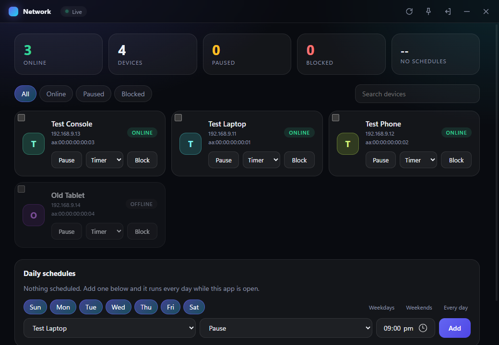

# Tollgate

Tollgate is a Windows desktop app that controls the devices on your eero mesh Wi-Fi network. From one window you can pause, resume, block, and unblock devices, set timers, and run daily schedules.

I built Tollgate as a parent. I had too little time to switch off my kids' internet by hand, so I made the app do it on a schedule.

This guide is for people who use the app. To build it from source, run `cargo build --release` and open `target/release/tollgate.exe`.

## Install

1. Download `Tollgate_0.1.1_x64-setup.exe` from the [latest release](https://github.com/mewtcor/tollgate/releases/latest).
2. Run the installer.
3. If Windows shows "Windows protected your PC", click **More info**, then **Run anyway**. The installer is not code-signed, so Windows warns about every new download.

The installer is for 64-bit Windows. I tested it only on Windows 11.

## Sign in

1. Open Tollgate.
2. Enter the email address or phone number on your eero account.
3. Click **Send code**. Eero sends you a code.
4. Enter the code and click **Verify**.

The device list appears and refreshes every 15 seconds. The app stays signed in until you click **Sign out** in the title bar.

## Pause or block a device

Each device has a card with a **Pause** button and a **Block** button.

- **Pause** cuts the device off from the internet. Click **Resume** to restore it.
- **Block** keeps the device off your network. Click **Block** a second time within 3 seconds to confirm. Click **Unblock** to let it back on.

To find a device, use the **All**, **Online**, **Paused**, and **Blocked** filters, or type in the search box.

## Pause a device for a set time

To pause a device and resume it automatically, choose a time from the **Timer** list on its card: 30 min, 1 hour, 2 hours, or 4 hours.

The timer survives a restart of the app. If you resume the device yourself before the time is up, the timer is cancelled.

## Rename a device

Double-click the device name, type a new name, and press Enter. The name is stored on this PC only. Eero and the eero app keep the original name.

## Act on several devices at once

1. Tick the checkbox on each card you want.
2. Use the bar that appears: **Pause**, **Resume**, **Timer**, **Block**, or **Unblock**.

To reuse a selection, type a name in the **Group name** box and click **Save group**. Click a group chip to select all of its devices. Click the **×** on a chip to delete the group. Groups are stored on this PC only.

## Schedule an action

Schedules repeat every week on the days you pick.

1. In **Daily schedules**, choose the days. Click **Weekdays**, **Weekends**, or **Every day** for a shortcut.
2. Choose a device, an action, and a time.
3. Click **Add**.

If you have devices selected, the schedule applies to all of them. To edit a schedule, click its pencil icon. To turn a schedule off without deleting it, clear its checkbox.

## Keep it running in the background

Timers and schedules run only while the app is running. Closing the window hides it in the system tray and keeps it running. Click the tray icon to show the window again.

Right-click the tray icon for these options:

- **Show** opens the window.
- **Start with Windows** starts the app hidden when you sign in to Windows.
- **Quit** stops the app, its timers, and its schedules.

To keep the window above other windows, click the pin icon in the title bar.

## Move settings to a device with a new address

When a device reconnects under a new entry, its schedules, nickname, and groups stay with the old entry. Open **Device got a new address?**, choose the old and the new entry, and click **Move settings**.

## Where the app stores data

Your sign-in session, schedules, and timers are in `%APPDATA%\dev.mewt.eero-widget`. Delete `session.txt` there to sign out by hand.

Tollgate saves the session in `session.txt` as plain text. Anyone who can read your Windows user profile can use it to act on your eero account. Click **Sign out** in the title bar to delete it when you stop using the app.

## Disclaimer

Tollgate is not made by or affiliated with eero or Amazon. "eero" is a trademark of its owner.

Tollgate talks to eero's unofficial cloud API. eero can change or block that API at any time, which can stop Tollgate from working. Use it at your own risk and follow eero's terms of service.
