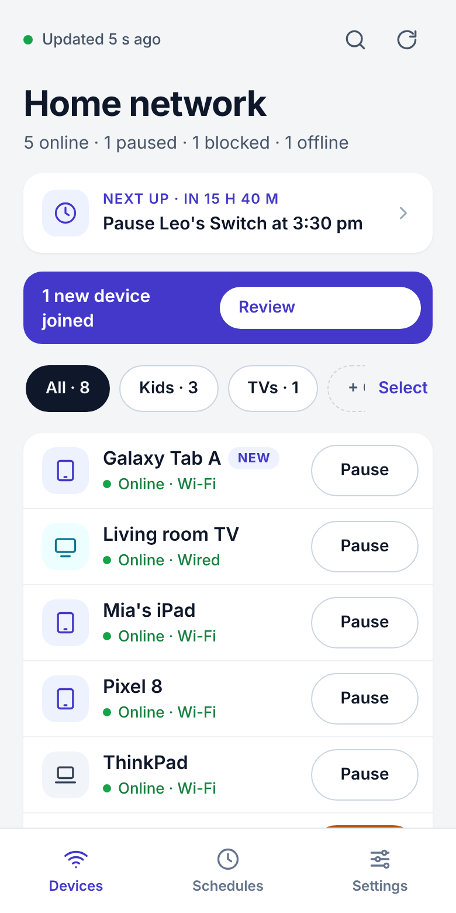

# Tollgate

Tollgate is a Windows desktop app that controls the devices on your eero mesh Wi-Fi network. From one window you can pause, resume, block, and unblock devices, set timers, and run daily schedules. It can also run around the clock on a Linux box and serve the same screen to any browser; see [Run it 24/7 on Linux](#run-it-247-on-linux).



I built Tollgate as a parent. I had too little time to switch off my kids' internet by hand, so I made the app do it on a schedule. Unlike eero's profile schedules, Tollgate's work per device or group. In the desktop app they run only while it is open; the Linux server runs them around the clock.

This guide is for people who use the app. To build it from source, run `cargo build --release` and open `target/release/tollgate.exe`.

## Install

1. Download `Tollgate_0.1.1_x64-setup.exe` from the [latest release](https://github.com/mewtcor/tollgate/releases/latest).
2. Run the installer.
3. If Windows shows "Windows protected your PC", click **More info**, then **Run anyway**. The installer is not code-signed, so Windows warns about every new download.

The installer is for 64-bit Windows. I tested it only on Windows 11.

## Sign in

1. Open Tollgate.
2. Enter the email address or phone number on your eero account.
3. Click **Send code**. Eero sends you a code.
4. Enter the code and click **Verify**.

The device list appears and refreshes every 15 seconds. The app stays signed in until you click **Sign out** on the **Settings** tab.

## Find your way around

Tollgate has three tabs at the bottom: **Devices**, **Schedules** and **Settings**. On a wide screen, panels open in the middle of the window; on a phone they slide up from the bottom.

## Pause or block a device

Each device in the list has one button. **Pause** cuts the device off from the internet, and **Resume** restores it. A blocked device shows **Unblock** instead.

Tap a device's name to open its panel. From there you can:

- pause it for 30 minutes, 1 hour, 2 hours, or until 7 am. It resumes on its own when the time is up. The timer survives a restart, and resuming it yourself cancels the timer.
- block it from your network. Tap **Block from network** a second time within 3 seconds to confirm. A blocked device stays off until you unblock it.
- rename it with the pencil icon. The name is stored by Tollgate only; eero and the eero app keep the original name.
- add it to groups or take it out of them, and see its schedules.

To find a device, tap the search icon at the top of the **Devices** tab.

## Use groups

Groups are chips above the device list, such as **Kids** or **TVs**. Tap a group to show only its devices, with **Pause all**, **Resume all** and a quick timer for the whole group. Tap **+ Group** to make one, and the pencil on a group to rename it, change its devices, or delete it. Groups are stored by Tollgate only.

To act on devices that are not in a group, press and hold a device, or tap **Select**. Tick the devices you want, then use the bar at the bottom: **Pause**, **Resume**, a timer, **Add to group**, **Block** or **Unblock**.

## Schedule devices

Schedules repeat every week on the days you pick. On the **Schedules** tab, tap **New schedule**.

1. Give it a name, such as Bedtime.
2. Under **Who**, pick a group or a device. A schedule for a group follows the group: add a device to the group and the schedule covers it too.
3. Under **What**, choose **Offline for a while** and set when the internet goes off and when it comes back, such as 9 pm to 7 am. If the end time is earlier than the start, it comes back the next morning. Or choose **One action** to pause, resume, block, or unblock at one time.
4. Pick the days. For an overnight schedule, pick the nights it starts. **School nights** means Sunday to Thursday.
5. Tap **Save**.

The bar at the top of the tab shows today's offline time. Tap a schedule to change or delete it, and use its switch to turn it off without deleting it. The next schedule to run is shown at the top of the **Devices** tab.

## Keep it running in the background

Timers and schedules run only while the app is running. Closing the window hides it in the system tray and keeps it running. Click the tray icon to show the window again.

Right-click the tray icon for these options:

- **Show** opens the window.
- **Start with Windows** starts the app hidden when you sign in to Windows.
- **Quit** stops the app, its timers, and its schedules.

To keep the window above other windows, click the pin icon in the title bar, or turn on **Keep on top** on the **Settings** tab.

## Spot new devices

The first time you sign in, Tollgate offers to mark the devices it finds as known. After that, when a device joins, a banner on the **Devices** tab says so. Tap **Review** to look at each new device and choose **Looks fine**, **Block it**, or give it a name first.

If the new device has the same name or maker as a device that has a name, schedules or groups but is no longer on the network, the review asks whether it is the same device and shows what would move. Tollgate never moves settings on its own.

## Move settings to a device with a new address

When a device reconnects under a new entry, its schedules, name and groups stay with the old entry. On the **Settings** tab, tap **Move settings to a new address**, choose the old and the new entry, and tap **Move settings**. You can also start from the new device's panel.

Tollgate identifies a device by its MAC address, so a change of IP address does not affect it. It cannot stop someone who changes or copies a MAC address. Phones and Windows 11 can use a private Wi-Fi address that changes when the network is forgotten and joined again. To avoid this, turn off the private address for your home Wi-Fi on your children's devices. Then lock that setting with Screen Time on iPhone or Family Link on Android.

## Where the app stores data

Your sign-in session, schedules, timers, and device names, groups and new-device tags are in `%APPDATA%\dev.mewt.eero-widget` (`session.txt`, `schedules.json`, `timers.json`, `prefs.json`). Delete `session.txt` there to sign out by hand. Earlier versions kept names, groups and new-device tags inside the window; the first start of this version moves them into `prefs.json`.

Tollgate saves the session in `session.txt` as plain text. Anyone who can read your Windows user profile can use it to act on your eero account. Tap **Sign out** on the **Settings** tab to delete it when you stop using the app.

## Run it 24/7 on Linux

The desktop app runs timers and schedules only while it is open. `tollgate-server` runs them all the time on an always-on Linux machine, such as an old Mac mini or a Raspberry Pi, and serves the same screen to any browser on your network. It is one file with the UI built in, and it needs no desktop.

### Install

On the Linux machine (Debian, Ubuntu or Linux Mint; other distros with systemd work the same way):

1. Install the build tools: `sudo apt install build-essential git`, then Rust: `curl --proto '=https' -sSf https://sh.rustup.rs | sh`.
2. Get the code: `git clone https://github.com/mewtcor/tollgate && cd tollgate`.
3. Run `./deploy/install.sh`. It builds the server, creates a `tollgate` system user, installs `/etc/systemd/system/tollgate.service`, asks you for a password for the web page, and starts the service.
4. Open `http://<the machine's address>:8787` on your phone or PC. Your browser asks for the password; any user name works.
5. Sign in to eero as in the desktop app, or copy your existing sign-in over (next section).

To update, run `git pull` and `./deploy/install.sh` again. Your sign-in, schedules and settings stay.

### Move over from the desktop app

1. On Windows, update Tollgate to this version and open it once, so it moves your device names and groups into `prefs.json`.
2. Quit Tollgate from the tray and turn off **Start with Windows**. If both run, both fire your schedules.
3. Copy `session.txt`, `schedules.json`, `timers.json` and `prefs.json` from `%APPDATA%\dev.mewt.eero-widget` to the Linux machine, then:

```bash
sudo systemctl stop tollgate
sudo install -o tollgate -g tollgate -m 600 session.txt schedules.json timers.json prefs.json /var/lib/tollgate/
sudo systemctl start tollgate
```

The desktop app's **Sign out** only deletes its own `session.txt`, so the copied session keeps working.

### Prepare the machine

- **Time zone.** Schedules use the machine's local time. Check it with `timedatectl` and set it with `sudo timedatectl set-timezone Pacific/Auckland` (your zone).
- **No sleep.** `sudo systemctl mask sleep.target suspend.target hibernate.target hybrid-sleep.target`, and set the desktop's power settings to never suspend.
- **Wired network** if you can. The machine controls your Wi-Fi, so it should not depend on it.
- **Power on after a power cut.** On a Mac mini 2010, `deploy/mac-mini-2010-autopower.service` sets this at each boot. Read the comment in it first, then: `sudo cp deploy/mac-mini-2010-autopower.service /etc/systemd/system/ && sudo systemctl enable --now mac-mini-2010-autopower`. Other models need a different setting. Test it by pulling the plug.

### Check on it

- `systemctl status tollgate` shows whether it runs. `journalctl -u tollgate -f` shows each schedule and timer as it fires, sign-ins, and errors.
- `curl http://localhost:8787/api/health` needs no password and answers `ok`, `signed_in` and the time of the scheduler's last pass. If eero ends the session, `signed_in` turns false and the log says so; sign in again from the web page.

### Settings

`tollgate-server` reads these environment variables. The service file sets the first two, and `/etc/tollgate.env` holds the password.

| Variable | Default | Meaning |
| --- | --- | --- |
| `TOLLGATE_DATA` | `/var/lib/tollgate` | Folder for the session, schedules, timers and settings |
| `TOLLGATE_BIND` | `127.0.0.1:8787` | Address and port to listen on; `0.0.0.0:8787` for your whole network |
| `TOLLGATE_PASSWORD` | none | Password for the web page. Required unless it listens on localhost only |

### Keep it private

Anyone who can open the page can pause and block your devices, so keep the password and do not forward port 8787 on your router. The page uses plain HTTP, so the password crosses your home network unencrypted. To use Tollgate away from home, put the machine and your phone on [Tailscale](https://tailscale.com) and open the page over that.

To build the server elsewhere: `cargo build --release -p tollgate-server` gives `target/release/tollgate-server`. It has no system library dependencies beyond the C library.

## Disclaimer

Tollgate is not made by or affiliated with eero or Amazon. "eero" is a trademark of its owner.

Tollgate talks to eero's unofficial cloud API. eero can change or block that API at any time, which can stop Tollgate from working. Use it at your own risk and follow eero's terms of service.
